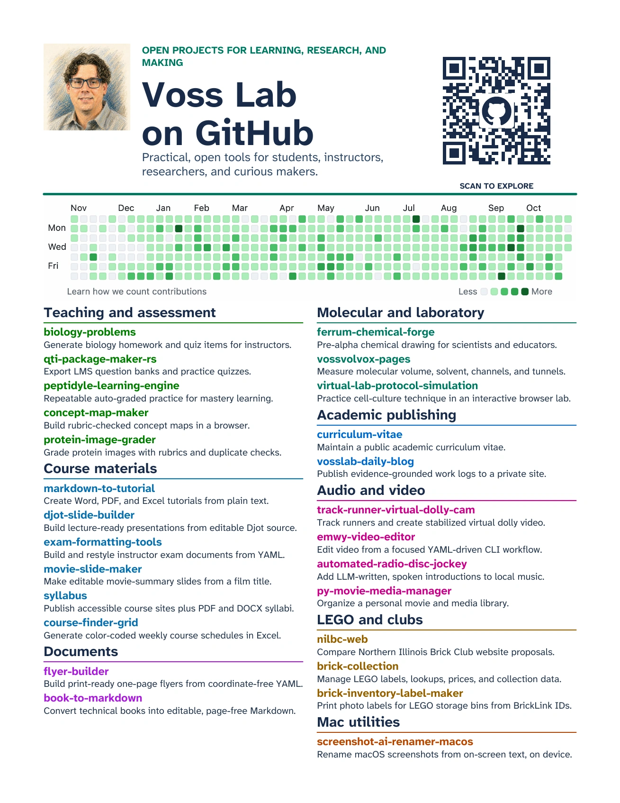

# flyer-builder

Build print-ready one-page flyers from coordinate-free YAML for educators, researchers, and makers, with editable local artwork and linked QR codes.

## Flyers

The repository includes two finished Letter-size examples: a podcast-and-games flyer and a GitHub project overview. They demonstrate nested rows and columns, local raster and vector artwork, clickable PDF links, and QR destinations.

<!-- screenshots:begin (managed by screenshot-docs) -->


<!-- screenshots:end -->

## Quick start

Install the declared Python dependencies, then build either included flyer:

```bash
source source_me.sh && python3 -m pip install -r pip_requirements.txt
source source_me.sh && python3 build_flyer.py -i flyers/github/github.yaml
```

The command writes `output/pdf/github.pdf`, a one-page Letter PDF with a linked profile QR code. Run the same command with `flyers/stvc/stvc.yaml` to build the Stump the Vibe Coder example.

## What it provides

- Author flyers through nested, weighted `row` and `col` blocks rather than page coordinates.
- Wrap text and preserve artwork proportions at its authored size within a one-page Letter layout.
- Embed local raster images and editable SVG artwork.
- Generate vector QR codes with quiet zones, optional center icons, labels, and PDF links.
- Keep authoring sources separate from generated PDFs and review images.

## Create a flyer

Start by copying an existing YAML source and its `assets/` directory. Point the builder at the new YAML file and give `-o` a PDF path when the default `output/pdf/<name>.pdf` path is not suitable.

```bash
source source_me.sh && python3 build_flyer.py \
  -i flyers/stvc/stvc.yaml \
  -o output/pdf/my_flyer.pdf
```

See [docs/YAML_FILE_FORMAT.md](docs/YAML_FILE_FORMAT.md) for the authoring contract and [docs/USAGE.md](docs/USAGE.md) for build examples.

## Documentation

- [docs/INSTALL.md](docs/INSTALL.md) lists dependencies and installation checks.
- [docs/USAGE.md](docs/USAGE.md) explains the command and supported YAML blocks.
- [docs/YAML_FILE_FORMAT.md](docs/YAML_FILE_FORMAT.md) defines the coordinate-free input format.
- [docs/CODE_ARCHITECTURE.md](docs/CODE_ARCHITECTURE.md) describes rendering and validation flow.
- [docs/FILE_STRUCTURE.md](docs/FILE_STRUCTURE.md) maps sources, assets, generated outputs, and tests.

## Maintainer checks

Run the focused build contract and refresh README screenshots with:

```bash
source source_me.sh && python3 -m pytest tests/test_flyer_render.py -q
bash devel/capture_flyer_screenshots.sh
```

The capture command rebuilds both examples and encodes the README screenshots as quality-90 WebP files.

## License

Source code is available under [LICENSE.LGPL-3.0](LICENSE.LGPL-3.0). Documentation and other non-code materials are available under [LICENSE.CC-BY-4.0](LICENSE.CC-BY-4.0). Bundled third-party fonts and logos retain their included upstream license or trademark terms.
